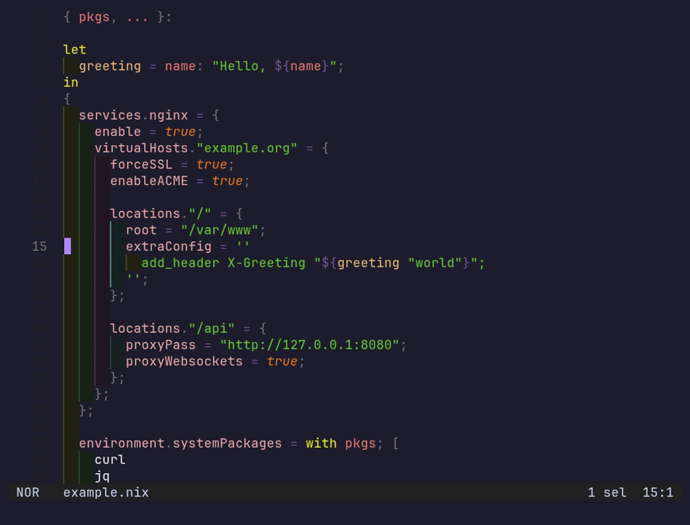

# rings.hx

Rainbow indentation for [Helix](https://helix-editor.com), as a
[Steel](https://github.com/mattwparas/steel) plugin. Tree rings, one per
level.



- Every indent level is a faintly tinted band with a thin guide line at its
  left edge, colours cycling per level (the look of VS Code's indent-rainbow
  and [indent-rainbowline.nvim](https://github.com/zyudneko/indent-rainbowline.nvim)).
- The bands carry on through blank lines inside a block.
- The guide of the block the cursor is in is drawn brighter, from the
  block's first line to its last.
- The indent width is detected per file; Helix's own indent guides are
  turned off while rings runs and come back with `:rings-stop!`.

## Requirements

- Helix built from the Steel branch (`mattwparas/helix`,
  `steel-event-system`), see its
  [STEEL.md](https://github.com/mattwparas/helix/blob/steel-event-system/STEEL.md).
- **The overlay API from [dna.hx](https://github.com/vitaliikindrat/dna.hx)
  (`helix-overlays.patch`) applied to that build.** Helix has no way
  for a plugin to draw styled characters at text positions, so this patch
  adds one, as a generic API rather than anything indent-specific:
  - `(set-overlays! scope text positions)` draws `text` over the grapheme at
    each char index, styled by the theme scope `scope`; one layer per scope.
    It is the mechanism Helix's own jump labels use.
  - `(set-inline-annotations! scope text positions)` inserts styled virtual
    text at each char index, the way inlay hints are drawn. rings uses it for
    blank lines, which have no graphemes to draw over.
  - `(clear-overlays! scope)`.

  Both kinds follow edits and respect soft wrap and scrolling, because the
  core does the layout. dna.hx carries it with the other Steel plugin
  APIs; they apply on their own and together.
- Optional: dna.hx's `helix-theme.patch`, for colours inherited from any
  theme (see [Theme](#theme)).

## Install

With forge:

```sh
forge pkg install --git https://github.com/vitaliikindrat/rings.hx.git
```

With Nix, the flake exposes `packages.<system>.rings` (the cog, with
`passthru.cogName = "rings"` for
[helix-plugins-nix](https://github.com/maxschipper/helix-plugins-nix)); the
patch comes from dna.hx:

```nix
helix-steel.overrideAttrs (old: {
  patches = (old.patches or [ ]) ++ [ inputs.dna.patches.overlays inputs.dna.patches.theme ];
})
```

Then in `~/.config/helix/init.scm`:

```scheme
(require "rings/rings.scm")

;; Optional. Defaults: "▏", 4 colours, no skipped levels, files up to 10000 lines.
;; #:skip 1 matches `indent-guides.skip-levels = 1`.
(rings-configure! #:char "▏" #:colors 4 #:skip 0 #:max-lines 10000)

(rings-start!)
```

## Theme

rings draws with theme scopes, `N` = 1 to the number of colours:

| Scope | Used for |
| --- | --- |
| `ui.virtual.indent-guide.N` | the guide line: `fg` for the line, `bg` for the band under it |
| `ui.virtual.indent-band.N` | the rest of the band: `bg` |
| `ui.virtual.indent-guide.active.N` | the guide of the cursor's block (falls back to `ui.virtual.indent-guide.active`) |

No theme has these, so rings inherits them: with dna.hx's theme patch it
takes the theme's `rainbow` (the colours of rainbow brackets; Helix's six
defaults for a theme without one) and mixes each over the theme's background,
7% for the band, 30% for the line and 80% for the active line, again whenever
the theme changes. A scope the theme sets itself is left alone, so a theme
can choose its own. Without the patch, and without them in the theme, the
guides come out in the theme's plain `ui.virtual` colour.

The screenshot sets them by hand: indent-rainbowline's defaults (yellow,
green, magenta, cyan) mixed the same way over a `#111111` background.

```toml
"ui.virtual.indent-guide.1" = { fg = "#58581f", bg = "#222214" }
"ui.virtual.indent-guide.2" = { fg = "#305830", bg = "#182218" }
"ui.virtual.indent-guide.3" = { fg = "#583058", bg = "#221822" }
"ui.virtual.indent-guide.4" = { fg = "#245353", bg = "#152020" }
"ui.virtual.indent-band.1" = { bg = "#222214" }
"ui.virtual.indent-band.2" = { bg = "#182218" }
"ui.virtual.indent-band.3" = { bg = "#221822" }
"ui.virtual.indent-band.4" = { bg = "#152020" }
"ui.virtual.indent-guide.active.1" = { fg = "#cfcf37", bg = "#222214" }
"ui.virtual.indent-guide.active.2" = { fg = "#64cf64", bg = "#182218" }
"ui.virtual.indent-guide.active.3" = { fg = "#cf64cf", bg = "#221822" }
"ui.virtual.indent-guide.active.4" = { fg = "#43c0c0", bg = "#152020" }
```

## Commands

| Command | What it does |
| --- | --- |
| `:rings-start!` | Turn rings on (Helix's own guides off) |
| `:rings-stop!` | Turn it off and give the guides back |
| `:rings-refresh` | Recompute the focused document |

## Limits

- On a blank line the bands are real inserted text, so the cursor there sits
  just after them rather than at column 0. Typing still goes to the right
  place.
- Tab-indented lines get no bands.
- Files over `#:max-lines` are left alone; edits redraw the whole document
  (debounced), which is fine at that size.

## License

MIT.
